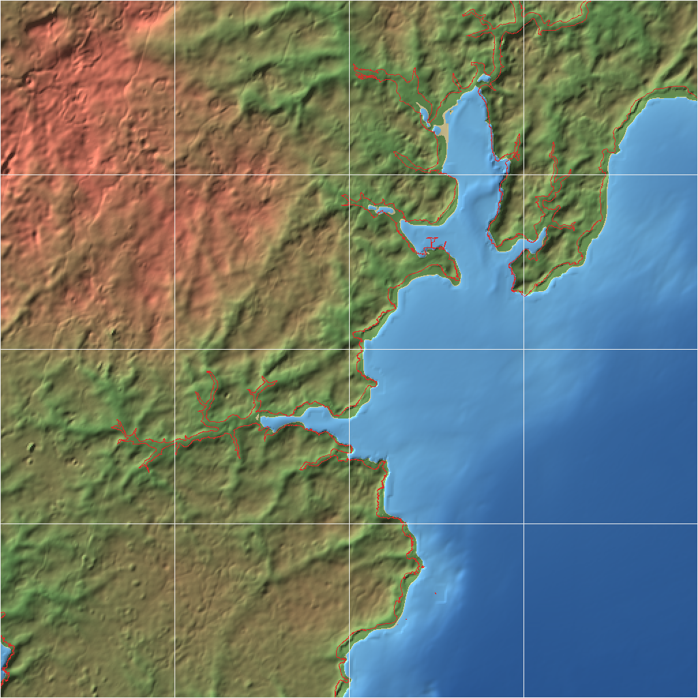
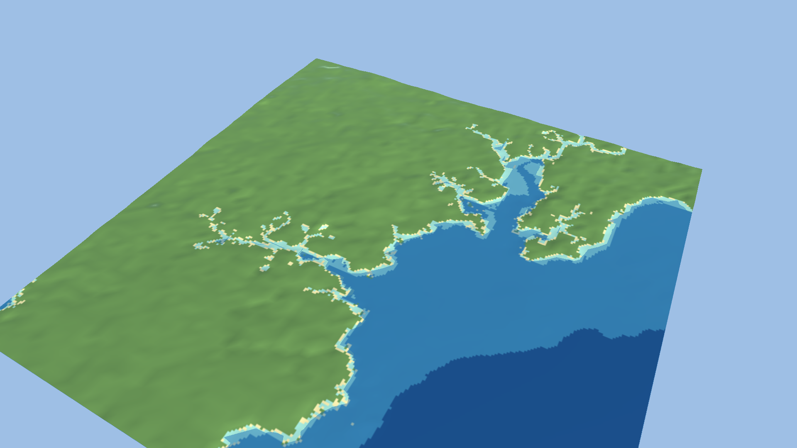
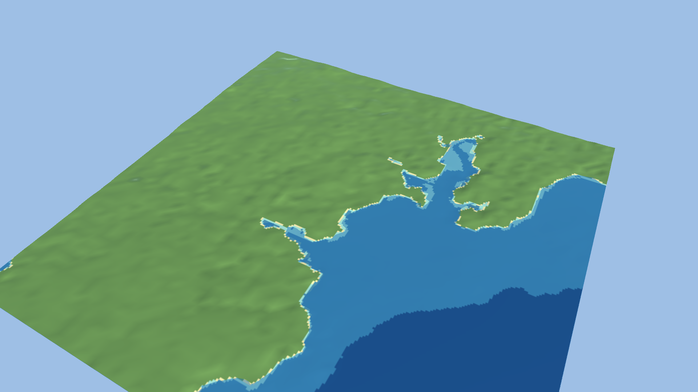

# Ocean Compiler (OceanBuilder)

A standalone Go CLI that turns a geographic bounding box into a tiled, multi-resolution, validated maritime world. It fetches (or imports) bathymetry, elevation and coastline data, puts them on one metric grid, cuts crack-free tiles with an LOD pyramid, records for every sample where it came from, and checks the result against the data it was built from. The output is a documented, engine-independent format ([docs/formats/world-v2.md](docs/formats/world-v2.md)); a Go reader, GeoTIFF export and a Unity (URP) adapter consume it. No game engine is needed to build, inspect or use a world.

Status: **0.2.** Sources: GMRT (bathymetry+topography) or your own GeoTIFFs, OpenStreetMap coastline and OpenSeaMap marks, optional EMODnet regional fill. One UTM zone per world. See [docs/roadmap.md](docs/roadmap.md) for what is missing and [docs/development-log.md](docs/development-log.md) for what was measured.

New here? [Tutorial: from an empty directory to an inspected world](docs/tutorials/first-world.md).



*Falmouth and Carrick Roads, built with `ocean world init falmouth && ocean build falmouth.world.json`: 16 tiles of 6.1 km at 48 m spacing. Red is the OpenStreetMap coastline; the land/water colour break is the DEM's own zero contour. Where they differ, the validator reports by how much.*

## Try it

Requirements: Go 1.22+, the GDAL command-line tools (`gdalwarp`, `gdal_translate`, `gdaltransform`, `ogr2ogr`, `gdalinfo`) on `PATH`. Tested with GDAL 3.13.

```bash
go build -o bin/ocean ./cmd/ocean

bin/ocean world init falmouth          # writes falmouth.world.json (more regions: examples/regions/)
bin/ocean world check falmouth.world.json   # grid, memory, projection distortion; no download
bin/ocean build falmouth.world.json    # downloads GMRT + OSM, writes output/falmouth (skips if up to date)
bin/ocean info output/falmouth         # region, levels, quality, every source with licence
bin/ocean validate output/falmouth
bin/ocean sample output/falmouth -lonlat -5.05,50.14      # depth/elevation/source, no GDAL needed
bin/ocean preview output/falmouth      # preview.png + preview.html
bin/ocean export output/falmouth -target geotiff -dest tif    # height/class/source GeoTIFFs for GIS
bin/ocean export output/falmouth -target unity -dest path/to/UnityProject
bin/ocean diff before after            # what changed between two builds
```

`ocean help` lists everything; `ocean <command> -h` gives flags. Progress goes to stderr (`-q` silences it, `-log-json` structures it); Ctrl-C cancels cleanly and a failed or cancelled build never damages an existing output. A rebuild with unchanged inputs returns immediately (`-force` overrides) and a rebuild that only changes derived settings reuses the cached warps.

**Source lock.** `ocean build w.world.json -update-lock` writes `w.lock.json` (URL → sha256, bytes, retrieval time) beside the config; commit it. Later builds fail with the list of differences if any resolved source (including after a cache eviction and re-download) has different bytes, a source is new, or a locked one is unused; `-lock off` disables, `-lock path` relocates. Cache hits are re-hashed: a corrupt cache file is re-downloaded, never reused. The lock covers every source in the manifest (GMRT, coastline, regional grid, refinement). The committed `falmouth`/`mindelo` locks pin the bytes of the author's cache: a fresh clone re-downloads (Overpass answers differ), fails the check, and should run `-update-lock` once or `-lock off`. Locking detects changes, it cannot recover old upstream data (keep the cache or the lock's sources if you need the bytes back).

Everything is non-interactive and scriptable: `build -json`, `validate -json`, `info -json`, `sample -json` and `diff -json` print machine-readable output, `validate` exits 1 on errors, downloads and warped rasters are cached in `.ocean-cache` (`ocean cache stats|clean [-stages]`).

### Validation output (real, Falmouth)

```text
WORLD: falmouth

Tiles: 16
Elevation coverage: 100.0%
Water cells backed by survey data: 91.9%
OSM coastline to DEM shoreline offset: median 101 m, p90 268 m
Neighbour edge mismatches: 0, level mismatches: 0

WARNINGS:
  [low-res-bathymetry] 1 tiles are mostly (>50%) interpolated/background-grid bathymetry rather than survey-backed
  [background-fill] 8.1% of water cells have no survey data and come from a coarse background grid (≈758 m resolution) resampled to 48 m
  [coast-misaligned] OSM coastline is 101 m (median) / 268 m (p90) from the nearest DEM shoreline; 31% of points have none within 384 m. ...

RESULT: BUILT WITH WARNINGS
```

Mindelo (Cabo Verde) is a useful contrast: only 3.7% of its water cells are survey-backed, the rest is the ~0.9 km GEBCO grid resampled to 48 m, and the validator says so (`docs/img/mindelo-preview.png`).

## What a built world contains

```text
output/falmouth/
  world.manifest.json      grid, CRS, encodings, LOD levels, sources (URL, time, sha256, licence), per-tile stats and file hashes, build id, input key
  ATTRIBUTION.txt          required credits for the sources used
  coastline.wgs84.geojson  OSM coastline as fetched
  seamarks.geojson         OpenSeaMap points (only with "seamarks": true in the world config)
  tiles/<level>/L<level>_<x>_<y>.height.f32   float32 metres, (N+1)² samples, shared edges with neighbours
  tiles/<level>/..depth.png     class per sample: 0 land, 1..n depth bands, 255 nodata
  tiles/<level>/..shore.png     255 where land touches water
  tiles/<level>/..source.png    where each sample came from: survey, background grid, land DEM, regional, conformed, refined
```

Level 0 is the full resolution; each further level keeps every second vertex of the one below (exact samples, no averaging; features narrower than 2^k cells can vanish at coarse levels) until one tile covers the world. Falmouth: 16 + 6 + 4 + 4 + 1 tiles over 5 levels (48 m to 768 m cells).

Tile ids are absolute indices on the UTM grid (`floor(easting / tile span)`), so the same place gets the same id whatever bounding box you ask for. Outputs are byte-identical for identical config and inputs (tested, including from a clean cache). Full specification: [docs/formats/world-v2.md](docs/formats/world-v2.md).

### Regional bathymetry (opt-in, EMODnet)

GMRT fills water without survey data from GEBCO_08 at about 758 m, which the validator flags (`gebco-fill`). `"regional_bathymetry": "emodnet"` fetches the EMODnet Bathymetry DTM (about 115 m; public WCS, the service declares Fees and AccessConstraints NONE, coverage lon -70.5..43, lat 11..90) and replaces **only** those GEBCO-filled water cells where it has water. GMRT survey cells, land and anything shallower than 2 m are never touched; replaced cells are not flagged survey-backed. The replacement ramps in over 8 cells from the nearest kept water cell, so the seam is not a cliff. Not available with `local` sources. The request uses the service's current `emodnet__mean` coverage, which is **not versioned**: after a cache clean and a new EMODnet release the same config builds a different world (the cached file's SHA-256 is in the manifest sources). Set `"regional_release": "2022"` (also 2016, 2018, 2020; the dated coverages the service lists) to pin a dated release instead; combine with the source lock for byte-level pinning.

**What the checks do, and do not, establish.** EMODnet declares no vertical datum, so before filling the build compares it with GMRT on cells both cover with survey data, and refuses the fill if any check fails:
- *units/sign*: median of (regional - GMRT) / depth over all shared survey cells within 5% (catches feet-for-metres and sign flips on any slope; tested);
- *misregistration*: moving the regional grid one cell must not cut the rms below 75% of the aligned rms (catches a shift of a cell or more; tested with a synthetic 2-cell shift; on real Falmouth the rms is nearly flat across +-70 m, 1.75 to 1.58 m, so smaller shifts are **not** detectable);
- *vertical offset*: median offset on **flat** cells (slope under 5% in both grids) within 5 m, at least 200 such cells (on steep slopes a 115 m and a 39 m grid differ by tens of metres from sampling alone). The offset is reported, not applied: there is no datum conversion.

Real data. **Falmouth**: 77,372 flat shared cells at a median depth of 49 m, median offset -0.35 m, rms 1.35 m, relative offset -0.8%: a usable offset measurement. 4,933 fill cells replaced (1.9% of the grid, largest change 8.6 m), 1,082 left at GEBCO. Seam steps (water pairs where one cell was replaced and its neighbour kept) have a median of 0.40 m against 0.49 m in the unfilled build (hard swap before blending: 1.43 m). **Mindelo**: only 871 flat shared cells, at a **median depth of 370 m**, so the +2.74 m "offset" (rms 4.49 m, relative -0.7%) says little about the shallow-water datum and is mostly resolution and slope scatter; the fill passes the guards but nothing proves it is closer to the truth than GEBCO (EMODnet is itself a compilation). It replaced 206,639 cells (62.8% of the grid) with changes up to 574 m (one interior cell goes from -144 m to -718 m); seam steps match the baseline (median 1.48 m against 1.27 m, p90 9.8 m against 10.5 m). Treat Mindelo's regional fill as unvalidated. Untested: NOAA CUDEM, areas where all shared survey cells are deep, regional fill combined with an *edited* LibreTerrain round trip (an unedited one on Falmouth with regional + conform + seamarks gives 0 of 16 tiles differing).

### Coastline conforming (opt-in)

By default the shore follows the DEM's zero contour and the validator reports how far the OSM coastline is from it (Falmouth: 101 m median, 268 m p90). `"coast_conform": "osm"` (optional `"coast_conform_max_m"`, default 300) makes land/water follow the OSM coastline instead, using the OSM rule that land is on the left of a coastline way: each cell within the radius takes the side of its nearest coastline sample, and cells where the DEM disagrees become land or water at +-0.5 m. Deep water (more than 10 m) and high ground (more than 30 m) are never flipped; flipped cells count as not survey-backed; the run is refused unless more than half of the labelled cells already agree with the DEM. Reversing every way flips every side, so the reversed reading would agree on exactly 1 minus that share; the guard refuses when the reversed reading fits better (Falmouth 81%, Mindelo 69%; reversing the real Falmouth coastline gives 15-16% and is refused in a test). **Licensing:** conforming writes OSM-derived land/water decisions into the height tiles and masks, not only the coastline file, so a conformed world is a derivative database of OSM (ODbL). Share-alike and attribution obligations are not analysed here. It runs before a LibreTerrain refinement, so edits see the final land/water split, and an unedited round trip with conforming on is byte-identical (tested).



Falmouth (real data, 48 m cells, built from `falmouth.world.json` plus `coast_conform` and `seamarks`): the DEM already agreed with the OSM sides on 81% of 38,876 labelled cells; 433 cells became land, 6,182 became water (2.6% of the grid; mostly intertidal flats and creeks the DEM calls land), 656 were skipped by the depth/height guards. Corroboration: buoys on DEM land fell from 8 of 31 to 1 of 31. Buoys are not an input but they are OSM data mapped from similar imagery, so this shows agreement between OSM layers, not ground truth. The manifest keeps the pre-conform offset as the headline (`coast_conform.offset_before`); the post-conform figure (median 24 m) compares the OSM line with a DEM made from it and is not evidence. Mindelo (Cape Verde, steep coast, 20 tiles): agreement only 69% of 30,587 labelled cells, 6,330 cells to water, 408 to land, 2,771 skipped by the guards; all 6 of 6 buoys sat on DEM land before and 1 of 6 after (offset before 142 m median / 331 m p90). Limits: creeks narrower than a cell stay speckled; the +-0.5 m flat strip at flipped cells is a cliff against steep neighbours; tidal datum is not modelled (OSM is a high-water line); coastline fragments are used as given, so ways cut off by the query bbox simply constrain less.

### Seamarks

`"seamarks": true` in the world config fetches every OSM element tagged `seamark:type` in the tile grid (buoys, lights, harbours, wrecks, anchorages...) and writes `seamarks.geojson`: WGS84 points (ways use their centre) with `seamark_type`, `name`, all raw tags, UTM `easting`/`northing` and the DEM elevation under each. Falmouth: 60 features. The query covers the whole tile grid, which reaches beyond the configured bbox. `stats.seamarks` in the manifest counts them by type and cross-checks floating marks (buoys) against the DEM: 8 of 31 sit on DEM land, all in the intertidal upper Penryn/Truro creeks (DEM 0 to 3 m at 48 m cells), while the other 23 are on water where expected, so that is data resolution/tide, not misplacement. Volunteer-mapped tagging, ODbL, not a nautical chart. Unity: `ocean export -target unity` copies the file; the importer fills `OceanWorldIndex.seamarks` (id, type, name, Unity position, tile id; floating marks at y = 0) and adds one empty marker GameObject per mark under `Seamarks` in the scene (Falmouth: 60, also read back through Addressables in the PlayMode test). No marker prefabs or light characteristics yet.

## Unity

`ocean export <world> -target unity -dest <project>` copies the world into `Assets/OceanWorld/<name>/` and installs the UPM package `Packages/com.oceancompiler.world` (embedded in the binary). `Ocean > Import World` (or batchmode) generates, under `Generated/`:

- `Terrains/<tile id>.asset`: TerrainData per tile with 5 flat-colour layers painted from the depth-class and shore masks (land, shore, shallow, mid, deep; no texture assets needed, so no render-pipeline dependency in the data).
- `Prefabs/<tile id>.prefab`: Terrain + TerrainCollider, already positioned in world space.
- `OceanWorldIndex.asset`: tile ids, UTM bounds, Unity-space position/size, elevation range, water/survey fractions, **neighbour ids** and an Addressables address per tile, plus UTM↔Unity conversion (`OceanWorldIndex.UtmToUnity`, `TileAt`, `LinkNeighbours`).
- `<name>.unity`: a scene with every tile and a translucent sea plane at y = 0.

Unity space: x = east, z = north, y = metres above the world's zero; the south-west corner of the world is (0,0).

**Addressables.** If `com.unity.addressables` (≥1.19) is installed, the import creates the group `Ocean_<world>` and registers every tile prefab at `ocean/<world>/<tile id>` (labels `ocean-tile`, `ocean-<world>`) and the index at `ocean/<world>/index` (label `ocean-index`). Your own groups and build settings are untouched; move the entries wherever your game wants them. At runtime load the index, pick tiles near the ship by `TileAt`, `Addressables.InstantiateAsync(entry.address)`, then `index.LinkNeighbours(entry, terrain, id => loadedTerrains[id])`. `Ocean > Addressables > Build And Check` builds the bundles and verifies every address and label (batchmode: `-executeMethod OceanCompiler.World.Editor.OceanAddressables.BuildAndCheckFromCommandLine`).

```bash
Unity -batchmode -projectPath <project> -executeMethod OceanWorldImporter.ImportFromCommandLine -quit
```



Rendered by the importer itself (`-oceanShot`, no `-nographics`) on Unity 6000.4.0f1. The importer checks six manifest checkpoints (highest and lowest vertices, four corners) against `Terrain.SampleHeight` through its own UTM→Unity conversion; Falmouth's largest error is 3 mm under both pipelines and any flip or offset fails the import. **Render pipeline: URP only** (Unity 6, URP 17.x, tested on 17.4; the package depends on it and the importer refuses to run under another pipeline). The demo project is URP. The PlayMode test below finds no pink shader pixels when viewing the terrain from 3.5 km (the probe frame is 77% terrain, asserted above 20% so a blank frame cannot pass). Terrains use the active pipeline's default terrain material (5 layers: land, shore, shallow, mid, deep). The sea plane uses URP Lit (transparent). Caveat: in a batchmode screenshot URP's far-LOD terrain draws magenta because the editor never ticks (the screenshot code raises `basemapDistance` in memory to avoid it); in play mode it renders correctly. `docs/img/falmouth-unity-seabed.png` shows the seabed with the sea plane hidden (`-oceanHideSea`): flat colour bands with hard edges and no visible relief, because the layers are flat colours and the water elevation is GMRT (39 m native at Falmouth) with GEBCO fill (758 m) where there is no survey; it is a data and placeholder-material view, not a finished underwater look. The importer reads float32 heights and level 0 only (it converts to Unity's 16-bit terrain itself); LOD levels above 0 are in the data but not imported. Not implemented: water shader, textures, nautical features. **Streaming:** `OceanTileStreamer` (`Streaming/`, compiled only with Addressables) loads and unloads tile prefabs around a target transform: add it at the world origin, set `index`, `target`, `loadRadiusM` (default 8000), `unloadRadiusM` (10000, never below the load radius, so tiles do not flip at the boundary) and `maxInFlight`. It loads nearest first, links terrain neighbours through `OceanWorldIndex.LinkNeighbours`, cancels loads of tiles that left range, and releases everything on destroy; `TileLoaded`/`TileUnloaded` events let the game attach seamarks or water. The distance logic is `OceanStreamingPlan` (no Addressables, unit-tested). PlayMode test on the Falmouth bundles: a target in the middle loads exactly the centre and its four edge neighbours with all four terrain neighbours linked, moving it to the far corner leaves three tiles and destroys the rest, and destroying the streamer releases all tiles. A failed load is retried after `retryAfterSeconds` (10), not every frame. Not done: floating origin (Unity float precision degrades far from the origin), clearing a neighbour link when its tile unloads (stale reference, harmless in the test), LOD levels, preloading by heading, measured load times or memory.

A PlayMode test in the package (`Tests/`, needs `testables` in the project manifest) loads the index and tiles through Addressables from the **built bundles** (asserts `BundledAssetProvider`), links neighbours and checks the six checkpoints against `SampleHeight` within 5 cm (Falmouth: passes, 4 tiles loaded). That runs in the editor's play mode, not in a standalone player build.

## Refining land in LibreTerrain (optional)

[LibreTerrain](../LibreTerrain) is a separate node-graph terrain editor; OceanBuilder only exchanges files with it.

```bash
ocean libreterrain export output/falmouth      # heightmap.exr + exchange.json (+ .lterrain if libreterrain-mcp is found)
# ...edit in LibreTerrain, build exports (EXR32)...
ocean libreterrain import output/falmouth-libreterrain <libreterrain output dir> -out refined/falmouth
ocean build refined/falmouth/falmouth-refined.world.json
```

Import writes an edit layer, not a replacement: only cells that are land in the original build change, sea floor and coastline stay as sourced, and the layer is recorded in the manifest. It refuses flipped, resampled or resized output. Measured behaviour: `docs/research/libreterrain.md`.

## Honest limits

- Not for navigation. GMRT's terms say its data must not be used for navigation, and this tool is for game worlds.
- GMRT's `topo` layer is filled with GEBCO_08 (~0.9 km) wherever no ~100 m multibeam survey exists. Output cells finer than that are interpolation. The manifest and validator report the surveyed fraction per tile.
- There is no vertical-datum reconciliation. Land DEMs, multibeam, and the OSM coastline use different references; the tool treats 0 m as the waterline and reports the horizontal offset to the OSM coastline instead of hiding it.
- One UTM zone per world. Projection scale deviation is reported in the manifest and bounded (a bbox beyond 0.5 % is refused). LOD levels are vertex decimations; they can alias thin features. Seamark and harbour data are volunteer-mapped OSM points.

## Docs

[Tutorial](docs/tutorials/first-world.md) · [World format](docs/formats/world-v2.md) · [Architecture](docs/architecture/overview.md) · [Decisions](docs/decisions/) · [Data sources](docs/research/data-sources.md) · [Ecosystem research](docs/research/ecosystem.md) · [Roadmap](docs/roadmap.md) · [Development log](docs/development-log.md) · [Contributing](CONTRIBUTING.md)

## Licence

MIT for the code (see [LICENSE](LICENSE)). Data keeps its own licence: GMRT CC BY 4.0 (citation required, see `ATTRIBUTION.txt`), GEBCO public domain, OpenStreetMap ODbL. Built worlds carry `ATTRIBUTION.txt`; do not redistribute them without it. Test fixtures in `testdata/` are small crops of those sources.
