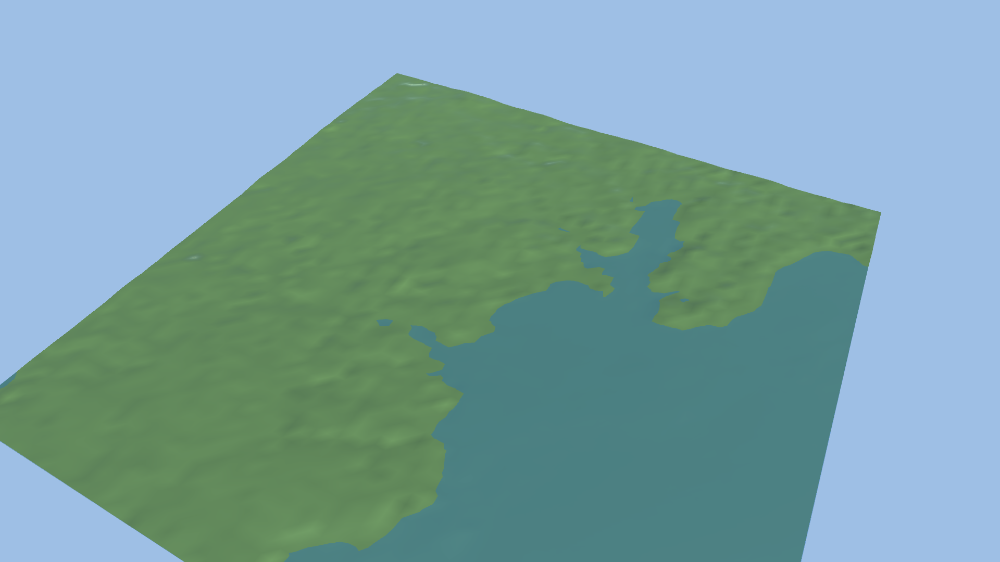

# Ocean Compiler

A Go CLI that turns a geographic bounding box into a tiled, validated sailing world for game engines. It fetches bathymetry and coastline data, puts them on one metric grid, cuts crack-free tiles, writes depth and shoreline masks, and checks the result against the data it was built from.

Status: **0.1, first vertical slice.** One bathymetry source (GMRT), one coastline source (OpenStreetMap), one engine (Unity). See [docs/roadmap.md](docs/roadmap.md) for what is missing.


*Falmouth and Carrick Roads, built with `ocean world init falmouth && ocean build falmouth.world.json`: 16 tiles of 6.1 km at 48 m spacing. Red is the OpenStreetMap coastline; the land/water colour break is the DEM's own zero contour. Where they differ, the validator reports by how much.*

## Try it

Requirements: Go 1.22+, the GDAL command-line tools (`gdalwarp`, `gdal_translate`, `gdaltransform`, `ogr2ogr`, `gdalinfo`) on `PATH`. Tested with GDAL 3.13.

```bash
go build -o bin/ocean ./cmd/ocean

bin/ocean world init falmouth          # writes falmouth.world.json
bin/ocean build falmouth.world.json    # downloads GMRT + OSM, writes output/falmouth
bin/ocean validate output/falmouth
bin/ocean preview output/falmouth      # preview.png + preview.html
bin/ocean export output/falmouth -target unity -dest path/to/UnityProject
```

Everything is non-interactive and scriptable: `build -json` and `validate -json` print machine-readable output, `validate` exits 1 on errors, downloads are cached in `.ocean-cache` (`ocean cache stats|clean`).

### Validation output (real, Falmouth)

```text
WORLD: falmouth

Tiles: 16
Elevation coverage: 100.0%
Water cells backed by survey data (GMRT mask): 91.9%
OSM coastline to DEM shoreline offset: median 101 m, p90 268 m
Neighbour edge mismatches: 0

WARNINGS:
  [low-res-bathymetry] 1 tiles are mostly (>50%) interpolated/global-grid bathymetry rather than survey-backed
  [gebco-fill] 8.1% of water cells have no survey data and come from the GEBCO_08 grid (≈758 m resolution) resampled to 48 m
  [coast-misaligned] OSM coastline is 101 m (median) / 268 m (p90) from the nearest DEM shoreline; 31% of points have none within 384 m. ...

RESULT: BUILT WITH WARNINGS
```

Mindelo (Cabo Verde) is a useful contrast: only 3.7% of its water cells are survey-backed, the rest is the ~0.9 km GEBCO grid resampled to 48 m, and the validator says so (`docs/img/mindelo-preview.png`).

## What a built world contains

```text
output/falmouth/
  world.manifest.json      grid, CRS, height encoding, sources (URL, time, sha256, licence), per-tile stats, build id
  ATTRIBUTION.txt          required credits for the sources used
  coastline.wgs84.geojson  OSM coastline as fetched
  tiles/0/L0_<x>_<y>.height.r16   uint16 heights, (N+1)² samples, shared edges with neighbours
  tiles/0/L0_<x>_<y>.depth.png    class per cell: 0 land, 1..n depth bands, 255 nodata
  tiles/0/L0_<x>_<y>.shore.png    255 where land touches water
```

Tile ids are absolute indices on the UTM grid (`floor(easting / tile span)`), so the same place gets the same id whatever bounding box you ask for. Outputs are byte-identical for identical config and inputs (tested).

## Unity

`ocean export` copies the world into `Assets/OceanWorld/<name>/` and installs an editor script. `Ocean > Import World` builds one `Terrain` per tile with neighbours linked, plus a sea-level plane at y = 0. In batchmode:

```bash
Unity -batchmode -projectPath <project> -executeMethod OceanWorldImporter.ImportFromCommandLine -quit
```



Rendered by the importer itself (`-oceanShot docs/img/falmouth-unity.png`, no `-nographics`) on Unity 6000.4.0f1, Built-in render pipeline. The importer also checks six manifest checkpoints (highest and lowest vertices, four corners) against `Terrain.SampleHeight` using its own UTM→Unity conversion; for Falmouth the largest error was 3 mm, and any flip or offset fails the import. The shader lookup falls back URP → HDRP → Standard but only Built-in has been run. Water is a flat translucent plane: no ocean shader or simulation yet.

## Refining land in LibreTerrain (optional)

[LibreTerrain](../LibreTerrain) is a separate node-graph terrain editor; OceanBuilder only exchanges files with it.

```bash
ocean libreterrain export output/falmouth      # heightmap.exr + exchange.json (+ .lterrain if libreterrain-mcp is found)
# ...edit in LibreTerrain, build exports (EXR32)...
ocean libreterrain import output/falmouth-libreterrain <libreterrain output dir> -out refined/falmouth
ocean build refined/falmouth/falmouth-refined.world.json
```

Import writes an edit layer, not a replacement: only cells that are land in the original build change, sea floor and coastline stay as sourced, and the layer is recorded in the manifest. It refuses flipped, resampled or resized output. Measured behaviour: `docs/research/libreterrain.md`.

## Honest limits

- Not for navigation. GMRT's terms say its data must not be used for navigation, and this tool is for game worlds.
- GMRT's `topo` layer is filled with GEBCO_08 (~0.9 km) wherever no ~100 m multibeam survey exists. Output cells finer than that are interpolation. The manifest and validator report the surveyed fraction per tile.
- There is no vertical-datum reconciliation. Land DEMs, multibeam, and the OSM coastline use different references; the tool treats 0 m as the waterline and reports the horizontal offset to the OSM coastline instead of hiding it.
- Single resolution level (no LOD pyramid), single UTM zone, no harbour or seamark features yet.

## Docs

[Architecture](docs/architecture/overview.md) · [Decisions](docs/decisions/) · [Data sources](docs/research/data-sources.md) · [Ecosystem research](docs/research/ecosystem.md) · [Roadmap](docs/roadmap.md) · [Development log](docs/development-log.md) · [Contributing](CONTRIBUTING.md)

## Licence

MIT for the code (see [LICENSE](LICENSE)). Data keeps its own licence: GMRT CC BY 4.0 (citation required, see `ATTRIBUTION.txt`), GEBCO public domain, OpenStreetMap ODbL. Built worlds carry `ATTRIBUTION.txt`; do not redistribute them without it. Test fixtures in `testdata/` are small crops of those sources.
