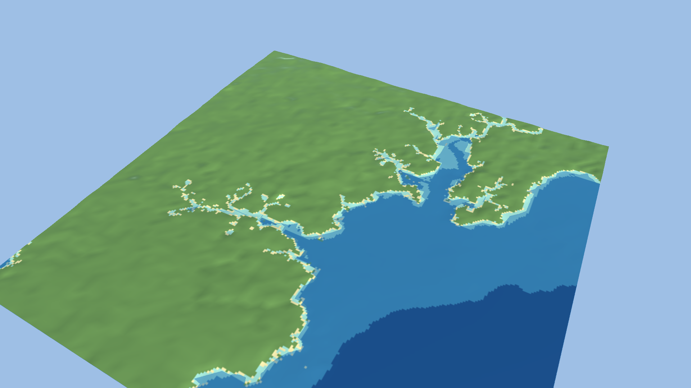

# Build options

Optional world-config settings and what they do to a build. Numbers below come from real Falmouth and Mindelo builds.

## Your own data

```json
{ "name": "mybay", "bbox": [-70.1, 41.6, -69.9, 41.8], "cell_m": 30,
  "local": { "topo": "bay_dem.tif", "mask": "bay_survey_mask.tif", "coastline": "coast.geojson",
             "license": "CC0", "attribution": "Agency name, product, year" } }
```

- `topo` is a GeoTIFF of elevation in metres, negative below the waterline, in any CRS GDAL can read.
- `mask` is optional. It is finite where the cell is a survey measurement.
- `coastline` is optional GeoJSON.
- Each path can also be an `http(s)://` URL, for example one national bathymetry tile. It is downloaded once into the cache with its sha256, retrieval time and your declared licence.
- `license` and `attribution` are required. They end up in the manifest and `ATTRIBUTION.txt`.
- Source nodata stays nodata (class 255). It is never filled.

## Land DEM over GMRT

GMRT has no land survey outside a few areas: it falls back to GEBCO_08 (about 0.9 km) and the raw download can contain isolated spikes (cells of 5-7 km among 300 m terrain over Cape Verde, checked in the downloaded file). For land, rank a land DEM above `gmrt`:

```json
"precedence": "listed", "vertical": {"datum": "EGM2008", "allow_mixed": true},
"sources": [
  {"id": "glo30", "type": "geotiff", "path": "land.tif", "nodata": 0, "vertical": {"datum": "EGM2008"}, "license": "...", "attribution": "..."},
  {"id": "gmrt", "type": "gmrt", "valid_max": 0, "vertical": {"datum": "MSL", "offset_m": 0, "offset_source": "..."}}
]
```

- `nodata: 0` makes the DEM's sea cells (Copernicus GLO-30 stores 0 over water) missing, so GMRT supplies the water. Coastal land at exactly 0 m also falls to GMRT.
- `valid_max: 0` on `gmrt` lets it supply only cells at or below the datum, so a GMRT land artefact cannot appear on a cell the DEM calls sea.
- GMRT states no datum; declare an offset and its source honestly, as in the example.

## Source lock

`ocean build w.world.json -update-lock` writes `w.lock.json` beside the config, with URL, sha256, bytes and retrieval time for every source. Commit it.

Later builds fail with a list of differences if a resolved source has different bytes (including after a cache eviction and re-download), a source is new, or a locked one is unused. Cache hits are re-hashed, so a corrupt cache file is re-downloaded and never reused. The lock covers every source in the manifest: GMRT, coastline, regional grid and refinement.

`-lock off` disables the check and `-lock path` relocates the file.

The committed `falmouth` and `mindelo` locks pin the bytes of the author's cache. On a fresh clone the build re-downloads, Overpass answers differ, and the check fails. Run `-update-lock` once, or use `-lock off`.

A lock detects changes. It cannot recover old upstream data, so keep the cache if you need the bytes back.

## Regional bathymetry (EMODnet)

Where GMRT has no survey, it fills water from GEBCO_08 at about 758 m, and the validator flags this (`gebco-fill`). `"regional_bathymetry": "emodnet"` fetches the EMODnet Bathymetry DTM (about 115 m) and replaces only those GEBCO-filled water cells where EMODnet has water.

- The service is a public WCS. It declares Fees and AccessConstraints NONE. Coverage is lon -70.5..43, lat 11..90.
- GMRT survey cells, land, and anything shallower than 2 m are never touched.
- Replaced cells are not flagged survey-backed.
- The replacement ramps in over 8 cells from the nearest kept water cell, so the seam is not a cliff.
- Not available with `local` sources.

The request uses the service's current `emodnet__mean` coverage, which is not versioned. After a cache clean and a new EMODnet release, the same config builds a different world. The cached file's SHA-256 is in the manifest sources. To pin a dated release, set `"regional_release": "2022"` (2016, 2018 and 2020 also work; these are the dated coverages the service lists). Combine it with the source lock for byte-level pinning.

### Guards

EMODnet declares no vertical datum. Before filling, the build compares it with GMRT on cells both cover with survey data, and refuses the fill if any check fails.

- Units and sign: the median of (regional - GMRT) / depth over all shared survey cells must be within 5%. This catches feet-for-metres and sign flips on any slope (tested).
- Misregistration: moving the regional grid by one cell must not cut the rms below 75% of the aligned rms. This catches a shift of a cell or more (tested with a synthetic 2-cell shift). On real Falmouth the rms is nearly flat across ±70 m (1.75 to 1.58 m), so smaller shifts are not detectable.
- Vertical offset: the median offset on flat cells (slope under 5% in both grids) must be within 5 m, with at least 200 such cells. On steep slopes a 115 m grid and a 39 m grid differ by tens of metres from sampling alone. The offset is reported, not applied, because there is no datum conversion.

### Measured results

Falmouth:
- 77,372 flat shared cells at a median depth of 49 m.
- Median offset -0.35 m, rms 1.35 m, relative offset -0.8%. That is a usable offset measurement.
- 4,933 fill cells replaced (1.9% of the grid, largest change 8.6 m). 1,082 stayed at GEBCO.
- Seam steps (water pairs where one cell was replaced and its neighbour kept) have a median of 0.40 m, against 0.49 m in the unfilled build. A hard swap before blending gave 1.43 m.

Mindelo:
- Only 871 flat shared cells, at a median depth of 370 m.
- The +2.74 m "offset" (rms 4.49 m, relative -0.7%) says little about the shallow-water datum. It is mostly resolution and slope scatter.
- The fill passes the guards, but nothing shows it is closer to the truth than GEBCO. EMODnet is itself a compilation.
- It replaced 206,639 cells (62.8% of the grid) with changes up to 574 m. One interior cell goes from -144 m to -718 m.
- Seam steps match the baseline: median 1.48 m against 1.27 m, p90 9.8 m against 10.5 m.

Treat Mindelo's regional fill as unvalidated.

Untested: NOAA CUDEM, areas where all shared survey cells are deep, and regional fill combined with an edited LibreTerrain round trip. An unedited round trip on Falmouth with regional, conform and seamarks gives 0 of 16 tiles differing.

## Coastline conforming

By default the shore follows the DEM's zero contour, and the validator reports how far the OSM coastline is from it (Falmouth: 101 m median, 268 m p90).

`"coast_conform": "osm"` makes land and water follow the OSM coastline instead. `"coast_conform_max_m"` sets the search radius (default 300).

How it decides:
- OSM puts land on the left of a coastline way. Each cell within the radius takes the side of its nearest coastline sample.
- Cells where the DEM disagrees become land or water at ±0.5 m.
- Deep water (more than 10 m) and high ground (more than 30 m) are never flipped.
- Flipped cells count as not survey-backed.
- The run is refused unless more than half of the labelled cells already agree with the DEM.
- Reversing every way flips every side, so the reversed reading would agree on exactly 1 minus that share. The build refuses when the reversed reading fits better. Falmouth agrees at 81% and Mindelo at 69%. Reversing the real Falmouth coastline gives 15-16% and is refused in a test.

It runs before a LibreTerrain refinement, so edits see the final land/water split. An unedited round trip with conforming on is byte-identical (tested).

Licensing: conforming writes OSM-derived land/water decisions into the height tiles and masks, not only the coastline file. A conformed world is therefore a derivative database of OSM (ODbL). Share-alike and attribution obligations are not analysed here.



### Measured results

Falmouth (48 m cells, built from `falmouth.world.json` plus `coast_conform` and `seamarks`):
- The DEM already agreed with the OSM sides on 81% of 38,876 labelled cells.
- 433 cells became land and 6,182 became water (2.6% of the grid). Most of the water cells are intertidal flats and creeks the DEM calls land. 656 cells were skipped by the depth and height guards.
- Buoys on DEM land fell from 8 of 31 to 1 of 31. Buoys are not an input, but they are OSM data mapped from similar imagery, so this shows agreement between OSM layers, not ground truth.
- The manifest keeps the pre-conform offset as the headline (`coast_conform.offset_before`). The post-conform figure (median 24 m) compares the OSM line with a DEM made from it, so it is not evidence.

Mindelo (Cape Verde, steep coast, 20 tiles):
- Agreement was only 69% of 30,587 labelled cells.
- 6,330 cells went to water, 408 to land, and 2,771 were skipped by the guards.
- All 6 of 6 buoys sat on DEM land before and 1 of 6 after. The offset before was 142 m median, 331 m p90.

### Limits

- Creeks narrower than a cell stay speckled.
- The ±0.5 m flat strip at flipped cells is a cliff against steep neighbours.
- Tidal datum is not modelled. OSM is a high-water line.
- Coastline fragments are used as given. Ways cut off by the query bbox constrain less.

## Seamarks

`"seamarks": true` fetches every OSM element tagged `seamark:type` in the tile grid (buoys, lights, harbours, wrecks, anchorages and so on) and writes `seamarks.geojson`.

- Points are WGS84. Ways use their centre.
- Each feature has `seamark_type`, `name`, all raw tags, UTM `easting` and `northing`, and the DEM elevation under it.
- The query covers the whole tile grid, which reaches beyond the configured bbox.
- Falmouth: 60 features.
- `stats.seamarks` in the manifest counts them by type and cross-checks floating marks (buoys) against the DEM. At Falmouth 8 of 31 buoys sit on DEM land, all in the intertidal upper Penryn and Truro creeks (DEM 0 to 3 m at 48 m cells). The other 23 are on water as expected. That is data resolution and tide, not misplacement.
- The data is volunteer-mapped, ODbL, and not a nautical chart.

In Unity, `ocean export -target unity` copies the file. The importer fills `OceanWorldIndex.seamarks` (id, type, name, Unity position, tile id; floating marks at y = 0) and adds one empty marker GameObject per mark under `Seamarks` in the scene. Falmouth gets 60, also read back through Addressables in the PlayMode test. There are no marker prefabs or light characteristics yet.
