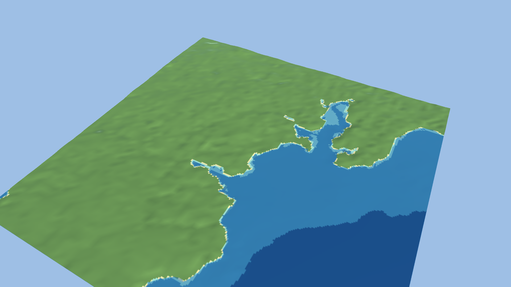

# Unity import and streaming

`ocean export <world> -target unity -dest <project>` copies the world into `Assets/OceanWorld/<name>/` and installs the UPM package `Packages/com.oceancompiler.world` (embedded in the binary). `Ocean > Import World`, or batchmode, generates this under `Generated/`:

- `Terrains/<tile id>.asset`: TerrainData per tile with 5 flat-colour layers (land, shore, shallow, mid, deep) painted from the depth-class and shore masks. No texture assets are needed, so the data has no render-pipeline dependency.
- `Prefabs/<tile id>.prefab`: Terrain plus TerrainCollider, already positioned in world space.
- `OceanWorldIndex.asset`: tile ids, UTM bounds, Unity-space position and size, elevation range, water and survey fractions, neighbour ids, an Addressables address per tile, and the UTM-to-Unity conversion (`OceanWorldIndex.UtmToUnity`, `TileAt`, `LinkNeighbours`).
- `<name>.unity`: a scene with every tile and a translucent sea plane at y = 0.

Unity space: x = east, z = north, y = metres above the world's zero. The south-west corner of the world is (0,0).

```bash
Unity -batchmode -projectPath <project> -executeMethod OceanWorldImporter.ImportFromCommandLine -quit
```

The importer reads float32 heights and converts them to Unity's 16-bit terrain itself. It imports LOD levels up to `-oceanMaxLevel N` (export them with `-level N`). Runtime LOD selection, async streaming and crack-hiding skirts are in [unity-lod.md](unity-lod.md).

## Render pipeline

URP only: Unity 6, URP 17.x, tested on 17.4. The package depends on it and the importer refuses to run under another pipeline. The demo project is URP.

Terrains use the active pipeline's default terrain material. The sea plane uses URP Lit (transparent).



The screenshot is rendered by the importer itself (`-oceanShot`, no `-nographics`) on Unity 6000.4.0f1.

Batchmode screenshots have a caveat. URP's far-LOD terrain draws magenta because the editor never ticks, so the screenshot code raises `basemapDistance` in memory to avoid it. In play mode it renders correctly.

`img/falmouth-unity-seabed.png` shows the seabed with the sea plane hidden (`-oceanHideSea`). It looks like flat colour bands with hard edges and no visible relief. The layers are flat colours, and the water elevation is GMRT (39 m native at Falmouth) with GEBCO fill (758 m) where there is no survey. It is a view of the data on placeholder materials, not a finished underwater look.

## What the importer checks

The importer checks six manifest checkpoints (highest and lowest vertices, four corners) against `Terrain.SampleHeight` through its own UTM-to-Unity conversion. Falmouth's largest error is 3 mm under both pipelines. Any flip or offset fails the import.

The PlayMode test finds no pink shader pixels when viewing the terrain from 3.5 km. The probe frame is 77% terrain, and the test asserts above 20% so a blank frame cannot pass.

A PlayMode test in the package (`Tests/`, needs `testables` in the project manifest) loads the index and tiles through Addressables from the built bundles, asserting `BundledAssetProvider`. It links neighbours and checks the six checkpoints against `SampleHeight` within 5 cm. Falmouth passes with 4 tiles loaded. It runs in the editor's play mode, not in a standalone player build.

## Addressables

If `com.unity.addressables` (1.19 or later) is installed, the import creates the group `Ocean_<world>`. It registers every tile prefab at `ocean/<world>/<tile id>` (labels `ocean-tile`, `ocean-<world>`) and the index at `ocean/<world>/index` (label `ocean-index`). Your own groups and build settings are untouched, so move the entries wherever your game wants them.

At runtime, load the index, pick tiles near the ship with `TileAt`, call `Addressables.InstantiateAsync(entry.address)`, then `index.LinkNeighbours(entry, terrain, id => loadedTerrains[id])`.

`Ocean > Addressables > Build And Check` builds the bundles and verifies every address and label. In batchmode:

```bash
-executeMethod OceanCompiler.World.Editor.OceanAddressables.BuildAndCheckFromCommandLine
```

## Streaming

`OceanTileStreamer` (in `Streaming/`, compiled only when Addressables is present) loads and unloads tile prefabs around a target transform. Add it at the world origin and set:

- `index`
- `target`
- `loadRadiusM` (default 8000)
- `unloadRadiusM` (default 10000, never below the load radius, so tiles don't flip at the boundary)
- `maxInFlight`

It loads nearest first, links terrain neighbours through `OceanWorldIndex.LinkNeighbours`, cancels loads of tiles that left range, and releases everything on destroy. A failed load is retried after `retryAfterSeconds` (10), not every frame. `TileLoaded` and `TileUnloaded` events let the game attach seamarks or water.

The distance logic is `OceanStreamingPlan`, which has no Addressables dependency and is unit-tested.

The PlayMode test on the Falmouth bundles checks three things. A target in the middle loads exactly the centre and its four edge neighbours, with all four terrain neighbours linked. Moving the target to the far corner leaves three tiles and destroys the rest. Destroying the streamer releases all tiles.

`OceanLodStreamer` supersedes it for worlds with LOD levels.

Not done: floating origin (Unity float precision degrades far from the origin), preloading by heading, and measured frame time, load times and GC in a player.

## Not implemented

Water shader, textures, nautical features. Seamark markers are covered in [options.md](options.md#seamarks).
